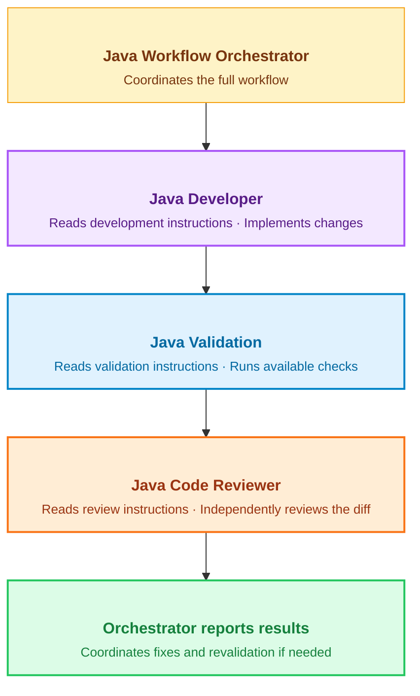
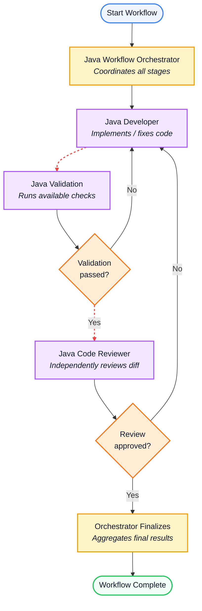

# Java Workflow Orchestrator

This repository tracks and manages the step-by-step process for Java development, validation, and review.

## Repository Customization Structure

```text
.github/
├── copilot-instructions.md
├── instructions/
│   ├── code-review.instructions.md
│   ├── development.instructions.md
│   └── validation.instructions.md
└── agents/
    ├── java-code-reviewer.agent.md
    ├── java-developer.agent.md
    ├── java-validator.agent.md
    └── java-workflow-orchestrator.agent.md
```

## Workflow Process Overview



## Stage Breakdown Reference

| Stage | Role | Responsibilities |
| :----- | :----- | :----- |
| 1. Orchestrator | Java Workflow Orchestrator | Coordinates the full workflow from start to finish. |
| 2. Development | Java Developer | Reads development instructions and implements required changes. |
| 3. Validation | Java Validation | Reads validation instructions and executes available checks. |
| 4. Code Review | Java Code Reviewer | Reads review instructions and independently reviews the diff. |
| 5. Reporting | Orchestrator reports results | Coordinates fixes and revalidation if needed. |

## Workflow Architecture Diagram



## Detailed Workflow Descriptions

1. **Java Workflow Orchestrator**: Manages state, assigns tasks, and coordinates overall workflow progress.
2. **Java Developer**: Implements software fixes, adds features, or addresses review/validation feedback.
3. **Java Validation**: Runs automated tests, linter checks, and static analysis tools.
   - If tests **fail**, control routes back to the **Developer**.
   - If tests **pass**, code proceeds to **Code Review**.
4. **Java Code Reviewer**: Performs an independent manual/diff code review.
   - If changes are **rejected**, control routes back to the **Developer**.
   - If changes are **approved**, execution completes.
5. **Finalize**: The Orchestrator aggregates final statuses, posts feedback, and closes the workflow.