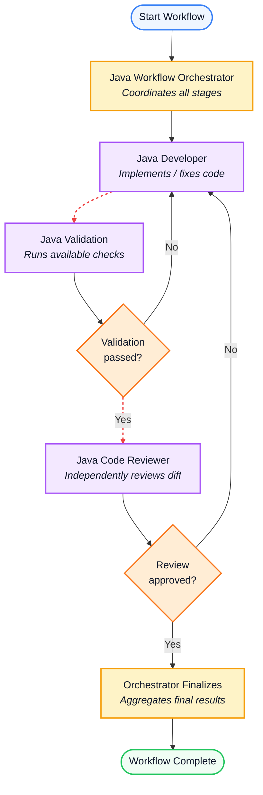

# Java Workflow Orchestrator

This repository tracks and manages the step-by-step process for Java development, validation, and review.

## Workflow Diagram

## Stage Descriptions

1. **Java Workflow Orchestrator**: Manages state, assigns tasks, and coordinates overall workflow progress.
2. **Java Developer**: Implements software fixes, adds features, or addresses review/validation feedback.
3. **Java Validation**: Runs automated tests, linter checks, and static analysis tools.
   - If tests **fail**, control routes back to the **Developer**.
   - If tests **pass**, code proceeds to **Code Review**.
4. **Java Code Reviewer**: Performs an independent manual/diff code review.
   - If changes are **rejected**, control routes back to the **Developer**.
   - If changes are **approved**, execution completes.
5. **Finalize**: The Orchestrator aggregates final statuses, posts feedback, and closes the workflow.